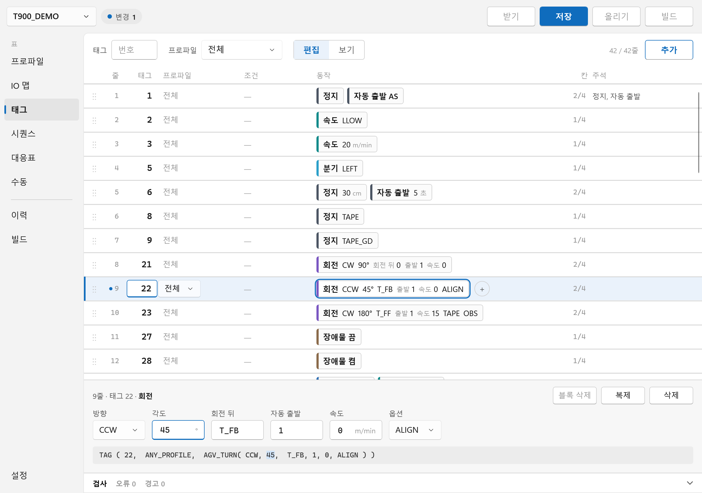

# AGV DCU 표 편집기

AGV DCU 펌웨어의 사이트 표(프로파일, 태그, 시퀀스, 수동 표)를 코딩 없이 고치는 Windows 프로그램.

- 사이트 C 표 파일을 읽어 블록으로 보이고, 고친 줄만 같은 C 파일로 다시 쓴다.
- 저장 전에 표를 검사한다(가려진 줄, 종류가 다른 이름, 닫히지 않은 사슬).
- 압축 태그 표 생성, C28x 빌드, 커밋, 회차 내기를 한 화면에서 한다.

## 받기

**먼저 .NET 10 Desktop Runtime (x64) 을 설치한다**: https://dotnet.microsoft.com/download/dotnet/10.0

[Releases](https://github.com/Leepy0/AGV_DCU_TableEditor/releases) 의 `TableEditor-vX.Y.Z-win-x64.zip` 을 풀어 `TableEditor.exe` 를 실행한다. 설치가 없다. 폴더에 `tedit.exe`(명령줄), `gcc\`(휴대용 컴파일러), `VERSION` 이 같이 있다.

## v0.2.3 변경

- 설치 크기 줄임: 302 MB → 76 MB(zip 98 MB → 28.6 MB). 휴대용 gcc 는 쓰는 헤더·라이브러리만 남김, .NET 런타임은 묶음에 넣지 않음
- .NET 10 Desktop Runtime (x64) 을 PC 에 따로 설치한다. 없으면 실행할 때 Windows 가 받는 곳을 알려 준다
- **v0.2.2 이하 사용자**: 업데이트 전에 .NET 10 Desktop Runtime 을 먼저 설치한다.

## v0.2.2 변경

- 조건: 차량 상태 줄마다 [반전] 토글(NOT 은 종류 목록에서 뺌), 인자 칸은 드롭다운(파라미터·키·낱말)·범위 숫자 칸
- 보고: 형식 "스테이션"·"숫자", 스테이션 칸 0\~23 고르기(칸 0 은 태그 1칸, 칸 1 이상은 2칸), 보고 종류 `IDLE`(코어 v0.59.0 이상 사이트)
- IO 맵: 신호마다 프로파일 지정(`io_map.h` 줄 끝 `/* pf: PF_A PF_B */`, 없으면 모두), 프로파일로 걸러 보기·"전체" 토글. 프로파일 이름 바꾸기는 지정도 같이 바꾼다
- 시퀀스 고르기: 줄 프로파일에 연결된 것 `ID → 표`, 나머지 "연결 없음"
- 업데이트 확인: 시스템 프록시 길 → 직접 길, 된 길 기억, 받기 재시도, `git ls-remote` 로 버전 확인, 방법별 실패 줄
- 검사: V-4 넓힘(`IDLE` 은 코어 v0.59.0 필요, 사이트 `#define` 이 보고 종류를 덮는 자리), I-7(IO 맵 pf 의 없는 프로파일 이름·틀린 글)
- 낱말: 조건 "빼기"→"삭제", "확장 조건"→"차량 상태", `OBS_OFF_AUTO` "장애물 감지 일시 중지", 변경 칩 "버리기"→"되돌리기", "코어 올리기"→"코어 버전 변경", 빌드 "개발·현장"→"시험용·현장용"
- **v0.2.1 에서 업데이트 확인이 시간 초과하던 PC**: v0.2.2 zip 을 손으로 한 번 받아 바꿔 넣는다. 이후는 자동.

## v0.2.1 변경

- 명령 목록: 같은 무리는 하나, 칸에서 형식 고르기, 추가 팝업(분류 버튼·인자 설명·검색)
- 라벨: GOTO 이름표, 라벨 인자 양식, 더블클릭으로 라벨 줄로 이동
- 빌드: 누르는 즉시 잠금, 빌드 탭, 진행 막대. cl2000 확인은 빠른 방식, 느리면 경고만
- `WAIT_OUT` 켬·끔·출력 목록, 상태 칸 숫자 입력, 도구 다시 확인 표시
- 편집: Ctrl+Z·Ctrl+Y, 우클릭 메뉴, 조건 입력 목록 정리, 자리 틀린 `X_`·`IF_` [바꾸기]
- 코어 v0.58.0 새 형식 읽기·쓰기(사이트 `core/VERSION` 이 v0.58.0 이상일 때). 기존 줄은 그대로
- 이름표 낱말 정리
- **v0.2.0 사용자**: 자동 업데이트로 받는다.

## v0.2.0 변경

- 자동 업데이트: 시작·1시간마다 새 버전 확인, 팝업·토스트, 설정에서 켜고 끔
- 시퀀스 검색·편집: 태그·시퀀스 거르기, 스텝 추가·바꾸기·지우기·끌기, 표 추가·지우기
- 칸 편집: 표 안에서 바로(F2·Enter·두 번 누르기)
- 동작 칩, ON/OFF 칸, TAPE 꼴 고르기, 프로파일 구분
- 장애물 감지 켬/끔 문구
- **v0.1.0 사용자**: 자동 업데이트가 없다. v0.2.0 을 Releases 에서 손으로 한 번 받아 바꿔 넣는다. 이후는 자동.

## 필요한 것

| 필요 | 용도 |
|---|---|
| 앱 저장소 clone | 편집할 사이트 표가 있는 저장소 |
| Git for Windows | 받기, 올리기, 이력, 되돌리기 |
| TI C2000 CGT 18.12.2.LTS | C28x 이미지 빌드 |
| PowerShell | 빌드 보조 |

압축 태그 표 생성용 gcc 는 zip 에 들어 있다. 따로 설치하지 않는다.

## 명령줄 `tedit`

| 명령 | 하는 일 |
|---|---|
| `tedit roundtrip <사이트 폴더>` | 읽고 그대로 쓴 바이트를 견줌 |
| `tedit stat <사이트 폴더>` | 문장·구역 개수 |
| `tedit headers <core 폴더>` | 문법 표와 코어 헤더 견줌 |
| `tedit check <사이트 폴더> [--core <core 폴더>]` | 표 검사 |
| `tedit pack <앱 루트> <사이트> [--gcc <경로>]` | 압축 태그·시퀀스 표 생성 |
| `tedit build <앱 루트> <사이트> [--field] [--name <이미지 이름>] [--gcc <경로>]` | 이미지 빌드 |
| `tedit round <앱 루트> <사이트> --app-url <주소> [--gcc <경로>]` | 회차 내기 |
| `tedit core-update <앱 루트> <사이트> <vX.Y.Z> --app-url <주소> [--from <주소>] [--gcc <경로>]` | 코어 버전 변경 |
| `tedit core-versions <앱 루트> [--core-url <주소>]` | 코어 버전 목록 |
| `tedit git-log-check <git.log> [--core-url <주소>]` | 깃 기록 검사 |

`--gcc` 를 주지 않으면 실행 파일 폴더의 `gcc\bin\gcc.exe` 를 쓴다.

## 만드는 법

| 하는 일 | 명령 |
|---|---|
| 개발 빌드(패키지 0개) | `dotnet build` |
| 배포 묶음·zip | `tools\release.ps1 -Version vX.Y.Z [-Gcc <mingw64 폴더>] [-Out publish] [-AppRepo <앱 저장소> -Site <사이트 폴더 이름>]` |

`release.ps1` 은 빌드·시험, 게시, 휴대용 gcc 추리기, 묶음 시험, zip·SHA-256 까지 한다. 결과는 `publish\` 에 나오고 커밋하지 않는다. 앱 저장소를 주면 그 사본에서 `pack`·`build` 까지 시험한다.

## 문서

| 문서 | 내용 |
|---|---|
| [docs/01_설계서.md](docs/01_설계서.md) | 구성, 엔진, 화면, 배포, 단계, 확인 요청 |
| [docs/02_구현계획.md](docs/02_구현계획.md) | 작업 순서와 공통 규칙 |

문법과 엔진은 공개 저장소 [AGV_DCU_Core](https://github.com/Leepy0/AGV_DCU_Core) 의 표 매크로를 따른다.

## 같이 넣은 gcc

zip 의 `gcc\` 는 WinLibs(MinGW-w64) 에서 C 용만 추린 것이다. 라이선스와 출처는 `gcc\licenses\`, `gcc\SOURCE.txt`.
